# 🚆 IRCTC Next Generation e-Ticketing System (NGeT)

[](https://openjdk.org/)
[](https://spring.io/projects/spring-boot)
[](https://spring.io/projects/spring-security)
[](https://hibernate.org/)
[](https://www.thymeleaf.org/)
[](LICENSE)

An enterprise-grade, Object-Oriented Analysis & Design (OOAD) implementation of the **Indian Railway Catering and Tourism Corporation (IRCTC Next Generation e-Ticketing System — NGeT)**.

---

## 🌟 Key Features

- **Pessimistic Concurrency Locking (`SELECT ... FOR UPDATE`):** Eliminates double-booking race conditions during high-contention booking windows (e.g. Tatkal opening) using database-level row locks.
- **Dynamic Distance-Based Telescopic Fare Engine:** Automatically scales passenger fares based on exact intermediate segment distance traveled (e.g., Kalaburagi $\rightarrow$ Bengaluru charges for 570 km instead of the full 1136 km Mumbai $\rightarrow$ Bengaluru route), with statutory railway floor fares.
- **Four Operational Railway Roles (RBAC):**
  - **Passenger:** Train search, real-time seat availability (CNF/RAC/WL), booking under General/Tatkal/Senior/Ladies quotas, e-Catering food ordering, IRCTC eWallet payments, live PNR tracking, automated cancellations, and official PDF e-ticket generation.
  - **Administrator:** Fleet management, interactive **Smart Route Stop Builder** with dynamic intermediate halt allocations (junctions: 10 min, waystations: 2 min), station hub, and user role management.
  - **Ticket Collector (TTE):** Electronic passenger reservation chart, real-time attendance tracking (`PRESENT` / `NO_SHOW`), and **1-click vacant berth re-allocation** to RAC and Waitlist passengers.
  - **Station Master:** Live station digital movement display board, platform assignment, delay logging, public audio/visual announcements, and reservation chart freezing.
- **IRCTC e-Catering Meal Voucher & Food Coupon:** Strictly conditional — generates an authentic food voucher (`ECAT-...`) with allocated coach/berth, itemized meals, paid amount, and pantry redemption instructions when meals are selected from the menu.
- **Authentic IRCTC Cancellation & Refund Policy:** Departure time brackets ($>48\text{h}$ full minus clerkage, $12\text{--}48\text{h}$ 25% deduction, $4\text{--}12\text{h}$ 50% deduction, $<4\text{h}$ 0% refund) with automated instant eWallet credit and cascading seat promotions (`RAC 1` $\rightarrow$ `CNF`, `WL 1` $\rightarrow$ `RAC`).
- **Realistic Railway Network:** 226 nationwide stations, 27 major corridors, and 116 realistic passenger, express, superfast, Rajdhani, Shatabdi, and Vande Bharat trains.

---

## 🏛️ System Architecture

```mermaid
flowchart TD
    subgraph L1["1. Presentation Layer (Thymeleaf & Bootstrap 5)"]
        UI_P["Passenger Portal"]
        UI_A["Admin Portal"]
        UI_T["TTE Portal"]
        UI_S["Station Master Portal"]
    end

    subgraph L2["2. Security & Filter Layer"]
        SF["Spring Security Filter Chain"]
        ASH["Custom AuthenticationSuccessHandler (Role Routing)"]
    end

    subgraph L3["3. Controller Layer"]
        C_Auth["AuthController"]
        C_Book["BookingController"]
        C_Admin["AdminController"]
        C_TTE["TicketCollectorController"]
        C_SM["StationMasterController"]
    end

    subgraph L4["4. Business Logic & OOAD Patterns"]
        S_Book["BookingService"]
        S_Pipe["BookingValidationPipeline (Chain of Resp.)"]
        S_Dist["DistanceFareService (Telescopic Engine)"]
        S_Fact["FareCalculatorFactory (Factory Pattern)"]
        S_State["TicketState Hierarchy (State Pattern)"]
        S_Alloc["SeatAllocationService (Seat Cascades)"]
        S_Wall["WalletService"]
        S_PDF["PdfGeneratorService (iText 5)"]
        S_Obs["Email & SMS Notifiers (Observer Pattern)"]
        S_Audit["AuditLogger (Singleton Pattern)"]
    end

    subgraph L5["5. Persistence Layer (Spring Data JPA)"]
        R_Train["TrainRepository (Pessimistic Locking)"]
        R_Ticket["TicketRepository"]
        R_Station["StationRepository"]
        R_Stop["TrainRouteStopRepository"]
        R_User["UserRepository & PassengerRepository"]
    end

    subgraph L6["6. Database Layer"]
        DB[("H2 Relational Database Engine")]
    end

    L1 --> SF --> ASH --> L3
    L3 --> L4
    L4 --> L5
    L5 --> L6
```



---

## 🧩 OOAD Design Patterns Applied

| Pattern | Package & Classes | Architectural Purpose |
| :--- | :--- | :--- |
| **Factory Pattern** | `com.irctc.pattern.factory`<br/>`FareCalculatorFactory`, `GeneralFareCalculator`, `TatkalFareCalculator`, `SeniorCitizenFareCalculator` | Encapsulates tariff calculation algorithms across different quotas (General, Tatkal +30%, Senior Citizen -50%). Isolates pricing math from booking controllers. |
| **State Pattern** | `com.irctc.pattern.state`<br/>`TicketState`, `ConfirmedState`, `RacState`, `WaitingState`, `CancelledState` | Polymorphically manages ticket lifecycle: cancellation eligibility, tiered refund calculations, and legal state transitions without conditional switch statements. |
| **Chain of Responsibility** | `com.irctc.pattern.chain`<br/>`BookingValidationPipeline`, `DateValidationHandler`, `TatkalValidationHandler`, `SeatAvailabilityValidator` | Sequentially executes pre-booking checks (date validity, Tatkal hours, senior citizen age >= 60, wallet balance, and seat capacity) before database writes. |
| **Observer Pattern** | `com.irctc.pattern.observer`<br/>`BookingObserver`, `EmailNotifier`, `SMSNotifier` | Asynchronously dispatches booking confirmations, cancellation alerts, and RAC promotion notices without coupling to database transactions. |
| **Singleton Pattern** | `com.irctc.pattern.singleton`<br/>`AuditLogger`, `DatabaseConnectionPool` | Provides synchronized, thread-safe instances for recording audit trails and database connections. |

---

## ⚡ Quick Start

### Prerequisites
- **Java Development Kit (JDK 21 or higher)**
- **Maven 3.8+** (or use included `./mvnw`)

### Running the Application

1. **Clone the repository:**
   ```bash
   git clone https://github.com/rjunereddy/IRCTC.git
   cd IRCTC
   ```

2. **Build and package:**
   ```bash
   ./mvnw clean package -DskipTests
   ```

3. **Start the server:**
   ```bash
   java -jar target/irctc-railway-system-1.0.0.jar
   ```

4. **Access the portal:**
   - Open browser: **`http://localhost:9090`**
   - H2 Console: `http://localhost:9090/h2-console` (JDBC URL: `jdbc:h2:file:./data/irctc_db`, User: `SA`, Password: *(empty)*)

---

## 👥 Default Demo Credentials

| Role | Username | Password | Direct Portal |
| :--- | :--- | :--- | :--- |
| **Passenger** | `traveler` | `user123` | `/passenger/dashboard` |
| **Administrator** | `admin` | `admin123` | `/admin/dashboard` |
| **Ticket Collector (TTE)** | `tte` | `tte123` | `/tte/dashboard` |
| **Station Master** | `stationmaster` | `sm123` | `/station-master/dashboard` |

*(A 1-click Quick Login bar is also available directly on the login page).*

---

## 🧪 Automated Test Suite

Run the full suite of unit and integration tests against an isolated in-memory test database:

```bash
./mvnw test
```

Includes verification for:
- Distance-based segment fare calculations
- Pessimistic write locking & concurrency
- Conditional e-Catering meal voucher emission
- TTE vacant berth re-allocations
- Station Master platform and delay updates
- State-dependent time-tiered refund rules

---

## 📄 Technical Documentation

Comprehensive 7-page technical specification PDF available:
- [`IRCTC_Railway_Reservation_System_Documentation.pdf`](./IRCTC_Railway_Reservation_System_Documentation.pdf)
